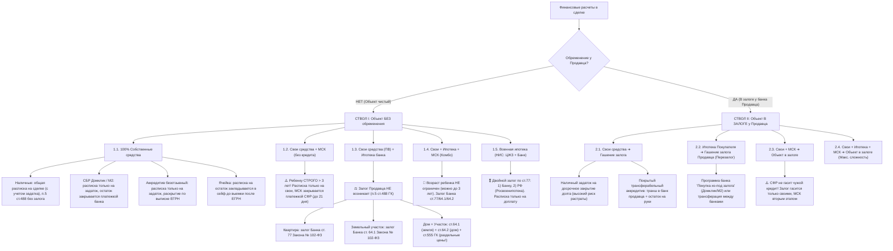

# Сквозная матрица связей документов и Стандарт Паспорта сделки (LegalEstate Matrix)
*Утверждено: 2026-10-26*

Данный документ регламентирует структуру **Паспорта сделки (Карточки сделки)** и **Сквозную матрицу связей**, определяющую точное соответствие полей между Паспортом и всеми генерируемыми документами пакета сделки (ПДКП, ДКП, Передаточный акт, Расписки, СОПД, Клиентские договоры «Этажи»).

---

## 1. Архитектура конвейера LegalEstate 2.0

```
┌────────────────────────────────────────────────────────────────────────┐
│ 1. ВХОД И ЮРИДИЧЕСКИЙ КОНСИЛИУМ (Штаб)                                 │
│    • Аудит рисков, выписок, залогов, арестов и семейного статуса       │
│    • Формирование Паспорта сделки + Имплементейшен-плана с пояснениями │
└──────────────────────────────────┬─────────────────────────────────────┘
                                   │
                                   ▼
┌────────────────────────────────────────────────────────────────────────┐
│ 2. МАШИННЫЙ ОТДЕЛ (Сквозная фабрика документов)                        │
│    • Сквозная имплантация данных по Матрице связей во ВСЕ документы:   │
│      [ ДКП ] + [ Акт ] + [ Расписки ] + [ СОПД ] + [ Договор «Этажи» ] │
│    • Выполнение генерации за 1–2 секунды без ручных правок             │
└──────────────────────────────────┬─────────────────────────────────────┘
                                   │
                                   ▼
┌────────────────────────────────────────────────────────────────────────┐
│ 3. ОТК (Отдел Технического Контроля / Pre-Release Gate)                │
│    • Проверка сторон через Estate Checker (паспорта, ФССП, банкротство)│
│    • Кросс-чекинг: совпадение сумм, дат, кадастров во всех документах   │
│    • Технический ГОСТ: шрифты «Этажи», 0 переносов `\n`, подписи       │
└──────────────────────────────────┬─────────────────────────────────────┘
                                   │
                                   ▼
┌────────────────────────────────────────────────────────────────────────┐
│ 4. РЕЛИЗ: ГОТОВЫЙ ПАКЕТ + ПАМЯТКА РИЕЛТОРУ ПО ПРОВЕДЕНИЮ СДЕЛКИ        │
└────────────────────────────────────────────────────────────────────────┘
```

---

## 2. Структура Паспорта сделки (`deal_passport.json`)

Паспорт сделки — это единый центр правды по сделке. Изменение любого значения в Паспорте автоматически обновляет все связанные пункты во всех документах пакета.

```json
{
  "deal_id": "12_Орнатские_Рыжаков",
  "deal_type": "mortgage_psb_accreditive", // cash | sber_transferation | domrf_pledge | mortgage_psb | etc.
  "status": "consilium_approved",
  
  "object": {
    "address": "Пензенская область, г. Пенза, ул. Зеленодольская, д. 74, кв. 45",
    "cadastral_number": "58:29:3001006:1846",
    "total_area": 32.1,
    "floor": 8,
    "rooms": 1,
    "pledge_info": "Ипотека в силу закона / отсутствует"
  },

  "parties": {
    "sellers": [
      {
        "full_name": "Орнатский Олег Александрович",
        "birth_date": "22.01.1978",
        "passport": "серия 56 22 № 718302, выдан УМВД России по Пензенской области 27.01.2023, код 580-001",
        "registration_address": "г. Пенза, проезд 40 лет Октября 2-й, дом 3",
        "share": "совместная / долевая",
        "bank_account": {
          "recipient": "Орнатский Олег Александрович",
          "account_number": "42307810948000614234",
          "bank_name": "КУРСКОЕ ОТДЕЛЕНИЕ N8596 ПАО СБЕРБАНК",
          "bic": "043807606",
          "corr_account": "30101810300000000606",
          "inn": "7707083893",
          "kpp": "583402001"
        }
      }
    ],
    "buyers": [
      {
        "full_name": "Рыжаков Дмитрий Александрович",
        "birth_date": "09.03.1986",
        "passport": "серия 56 05 № 588224, выдан ОВД Железнодорожного района г. Пензы 26.07.2006, код 582-004",
        "registration_address": "г. Пенза, ул. Мира, д. 34, кв. 48",
        "share": "индивидуальная"
      }
    ],
    "representatives": []
  },

  "finance": {
    "total_price": 3500000,
    "deposit": 50000,
    "own_funds": 653500,
    "mortgage_funds": 2796500,
    "mortgage_bank": "ПАО «Банк ПСБ»",
    "accreditive_days": 90,
    "accreditive_expenses_paid_by": "Покупатель / Продавец"
  },

  "dates_and_deadlines": {
    "vacate_days": 14,
    "registration_discharge_days": 14,
    "signing_date": "26.10.2026",
    "submission_for_registration_days": 2
  },

  "furniture_and_equipment": [
    "Кухонный гарнитур со встроенной техникой",
    "Сплит-система",
    "Осветительные приборы и сантехническое оборудование"
  ],

  "agency_etagi": {
    "contract_number": "ЭТ-2026/10-12",
    "service_type": "Покупка / Продажа / Юридическое сопровождение",
    "commission_amount": 85000,
    "realtor_name": "Фролов Илья Сергеевич"
  }
}
```

---

## 3. Сквозная матрица связей полей (Cross-Document Variable Matrix)

В таблице ниже показано, как конкретное поле из **Паспорта сделки** транслируется в соответствующие разделы каждого документа:

| Поле Паспорта сделки | Предварительный договор (ПДКП) | Основной договор (ДКП) | Передаточный акт | Расписки | СОПД «Этажи» | Клиентский договор «Этажи» |
| :--- | :--- | :--- | :--- | :--- | :--- | :--- |
| **Стороны: Продавцы** | Преамбула + Реквизиты | Преамбула + п. 5 Подписи | Шапка + Подписи | Получатель денег | Субъект ПДн | Заказчик / Клиент (при продаже) |
| **Стороны: Покупатели** | Преамбула + Реквизиты | Преамбула + п. 5 Подписи | Шапка + Подписи | Плательщик денег | Субъект ПДн | Заказчик / Клиент (при покупке) |
| **Объект: Адрес, Кадастр, Площадь** | Раздел 1 (Предмет) | Раздел 1 (Предмет) | п. 1 (Объект) | Текст расписки | Шапка согласия | Приложение 1 (Объект) |
| **Общая цена объекта** | п. 2.1 (Цена) | п. 1.4 / 2.2 (Цена) | — | Общая сумма (в ген. расписке) | — | п. 1.2 (Базовая стоимость) |
| **Задаток (сумма)** | п. 2.2 (Порядок расчетов) | п. 1.5 (Оплата до сделки) | — | Текст Расписки на задаток | — | — |
| **Кредитные средства и Банк** | п. 2.3 | п. 1.5–1.6 (Условия кредита) | — | — | — | Условия сделки (ипотека) |
| **Реквизиты счета Продавца** | — | п. 1.6 / 2.3 (Аккредитив) | — | — | — | Реквизиты для перечисления |
| **Срок освобождения (дней)** | п. 5.1 (Освобождение) | п. 2.1 / 3.2 (Освобождение) | п. 1 (Ключи переданы) | — | — | — |
| **Срок выписки (дней)** | п. 5.2 (Снятие с учета) | п. 5.2 (Рег. учет) | п. 4 (Гарантия выписки) | — | — | — |
| **Опись мебели и техники** | п. 6.8 (Передаваемое имущество) | п. 3.6 (Имущество в цене) | п. 3 (Опись имущества) | — | — | — |
| **Показания счетчиков** | — | — | п. 2 (Таблица счетчиков) | — | — | — |
| **Комиссия агентства** | — | — | — | — | — | Раздел 3 (Цена услуг) + Акт |

---

## 4. Регламент работы ОТК (Отдел Технического Контроля перед релизом)

Перед выдачей пакета документов пользователю запускается 3 уровня автоматической проверки:

1. **Юридический ОТК (Estate Checker Integrity)**:
   - Сверка ФИО и паспортов сторон с базами действительности МВД.
   - Проверка продавцов на банкротство (ЕФРСБ) и исполнительные производства (ФССП > 500 000 руб.).
   - Проверка соответствия владельца счета (счет для раскрытия аккредитива строго принадлежит продавцу по ДКП — Правило 16).
2. **Кросс-документальный ОТК (Cross-Check Consistency)**:
   - Сумма задатка в ПДКП == Сумма задатка в ДКП == Сумма в расписке.
   - Кадастровый номер и площадь в ДКП == в Передаточном акте == в Клиентском договоре.
   - Срок освобождения (14 дней) и выписки (14 дней) синхронизированы в ДКП и Акте.
   - Опись мебели в ДКП п. 3.6 буква в букву совпадает с п. 3 Акта приема-передачи.
3. **Технический ОТК (Visual & Typography QA)**:
   - Строго Times New Roman 10 pt (подписи 8–8.5 pt).
   - Фирменная палитра «Этажи» (Красный `#DC2626`, Серый `#475569`, Белый `#FFFFFF`).
   - Строго **0 внутрипараграфных переносов `\n`** во всем пакете.
   - Передаточный акт и Расписка — ровно **1 страница А4** без висячих строк.
   - Подписи — полноширинные построчные блоки во всю ширину страницы (Правило 10) с `keep_with_next = True`.

---

## 5. Имплементейшен-план (Экспертная дорожная карта сделки)

При каждом формировании пакета формируется краткая справка для риелтора:
- **Ключевые контрольные точки сделки**: когда раскрывается аккредитив, когда подается заявление в банк, когда освобождается объект.
- **Правовое обоснование спорных пунктов**: почему выбран именно такой срок выписки, почему залог продавца по ст. 488 ГК исключен, почему применена ст. 381.1 ГК (обеспечительный платеж) или трансферация.
- **Чеклист действий на сделке**: какие документы взять в МФЦ/банк, какие расписки подписать до входа в переговорную, какие акты подписать после получения денег.


---

## 6. Исчерпывающее дерево финансовых расчетов и залогов (Settlement & Pledge Tree)
*Разработано на основе авторской схемы Ильи Фролова и 624 реальных сделок (Сбер, ВТБ, Домклик, М2, МСК, Военная ипотека)*

Интерактивная визуальная версия доступна в файле [`docs/deal_settlement_tree.html`](deal_settlement_tree.html) (открывается в любом браузере и на смартфонах).



### 6.1. Регламент расписок и закрывающих документов
1. **Наличные средства**: Продавец выдает расписку **в день сделки** на фактически переданную сумму (включая задаток).
2. **СБР (Номинальный счет) и Аккредитив**: В день сделки составляется расписка **ИСКЛЮЧИТЕЛЬНО на сумму задатка / наличного первоначального взноса**. На сумму, задепонированную в СБР/аккредитиве, расписка в день сделки **НЕ ПИШЕТСЯ** — фактом оплаты является электронное платежное поручение банка о раскрытии с отметкой об исполнении.
3. **Банковская ячейка**: Расписка на сумму в ячейке закладывается в отдельный пакет ячейки либо передается на ответственное хранение и вручается Покупателю **строго при совместной выемке денег после регистрации ЕГРН**.
4. **МСК (СФР) и Сертификаты (Херсон, Молодая семья)**: Фактом оплаты является зачисление казначейских средств на счет Продавца (до 21 дня). Расписка в день сделки на эту сумму не выдается.

### 6.2. Регламент статей о залогах
* **п. 5 ст. 488 ГК РФ**: Включается **ВО ВСЕХ** договорах в отрицательной форме: *«Право залога у Продавца НЕ возникает»*.
* **ст. 77 Федерального закона № 102-ФЗ**: Применяется для квартир и апартаментов в пользу кредитующего банка.
* **ст. 64.1 Федерального закона № 102-ФЗ**: Применяется для земельных участков.
* **ст. 64.2 Федерального закона № 102-ФЗ**: Применяется для жилых домов.
* **ст. 555 ГК РФ**: При покупке жилого дома с земельным участком **ОБЯЗАТЕЛЬНО** раздельное указание цены дома и цены земельного участка (существенное условие, без которого договор считается незаключенным).
